# User Experience Design

This document has the app map and wireframes for the Minimum Viable Product (MVP) of CareerHive. They were made in [draw.io](https://draw.io). The source files and exported PNGs are in the [`ux-design`](./ux-design) folder:

- [`app-map.drawio`](./ux-design/app-map.drawio.xml): the app map
- [`wireframes.drawio`](./ux-design/wireframes.drawio.xml): all wireframes, one page per screen

## Prototype

**[View the clickable prototype on Figma](https://www.figma.com/proto/R4lliiZKlfzQkVtCScmLcN/CareerHive-Prototype?node-id=1-2&starting-point-node-id=1-2)**

The prototype was built in [Figma](https://www.figma.com/prototyping/) using the wireframes below as its screens ([editor view](https://www.figma.com/design/R4lliiZKlfzQkVtCScmLcN/CareerHive-Prototype)). It starts on the **Welcome** screen.

- Every button and link that moves between screens is clickable, including the menu on every logged-in screen.
- Pop-ups and overlays open and close: the menu, filters, Save to Tracker, AI Match analysis, New Post, Update Stage, and the Remove confirmation.
- Tapping "Log In" the first time shows the error screen, so both versions of Log In can be seen. Tapping "Log In" again goes to Home.
- Closing the menu returns to whichever screen it was opened from.
- Longer screens scroll.

## App Map

The app map shows the main screens of CareerHive and how they relate to each other as parent and child screens.

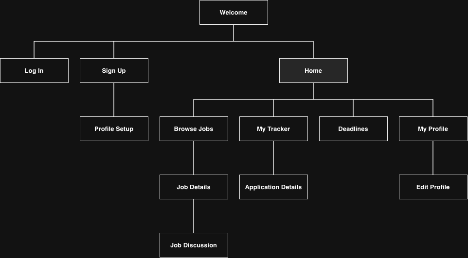

- **Welcome** is the first screen a logged-out user sees. From there they can log in or create an account.
- New users go through **Profile Setup** right after signing up, so we can match them with relevant jobs.
- **Home** (shaded) is the main hub once a user is logged in. The four main sections (**Browse Jobs**, **My Tracker**, **Deadlines**, and **My Profile**) are children of Home. Users can also get to all of them from the menu on every logged-in screen.
- Pop-ups and overlays (filters, the menu, forms, confirmations) aren't separate screens, so they're not on the map. They're listed with their parent screen in the wireframes section below.

## Wireframes

Some notes that apply to all of the wireframes:

- They're all designed for a mobile screen, and every diagram is the same width (360px). Heights change depending on how much content a screen has, and longer screens scroll.
- The header, with the logo on the left and the menu button (three lines) on the right, sits in the same spot on every screen. The menu button only shows up once the user is logged in.
- Gray boxes are placeholders for images, like company logos and user photos.
- Underlined text is a link. Dark buttons are the main action on a screen, and outlined buttons are secondary actions.
- Names, companies, and jobs are all made up and are not real. They're only there to show what kind of content goes in each spot.

---

### Account Screens

#### 1. Welcome

The landing page for anyone who isn't logged in. It explains what CareerHive does in a sentence or two and gives two options: sign up or log in.

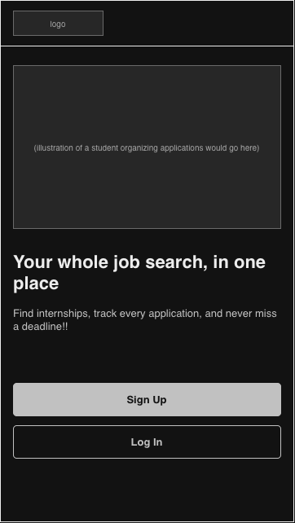

#### 2. Log In

Returning users log in with their email and password.

- After a successful login, the user goes to **Home**.
- "Sign up" at the bottom goes to **Sign Up**.

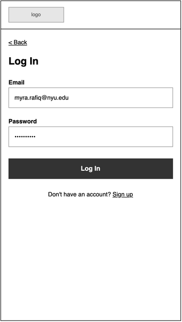

#### 3. Log In with Error

What Log In looks like if the email or password is wrong. An error message shows up above the Log In button and the password field is cleared so the user can try again.

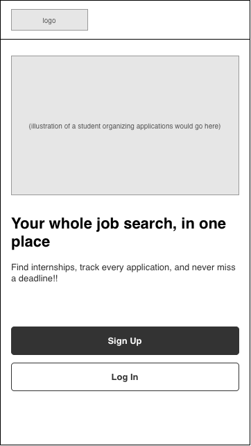

#### 4. Sign Up

New users create an account with their name, school email, and a password.

- The two password fields have to match before the account is created. If something is missing or invalid, an error message shows up above the button, in the same style as on Log In with Error.
- After signing up, the user goes straight to **Profile Setup**.

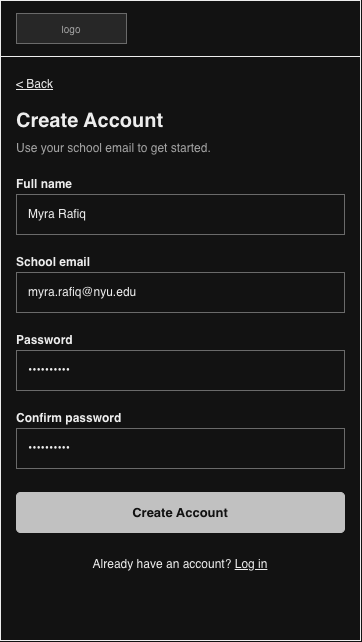

#### 5. Profile Setup

Collects the info CareerHive uses to recommend jobs and calculate AI match scores: major, graduation date, skills, the type of roles they want, preferred locations, and work authorization.

- Typing a skill or location and pressing enter adds it as a tag below the field. Tapping a tag removes it.
- The work authorization answer is used to point out jobs that offer visa sponsorship, which matters a lot for international students.
- "Skip for now" takes the user to Home. They can fill out their profile later from **Edit Profile**, but recommendations won't be as good until they do.

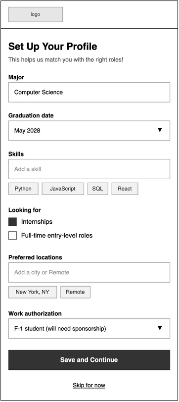

---

### Home and Navigation

#### 6. Home

The dashboard a user sees after logging in. It shows what needs their attention right now:

- **Upcoming Deadlines**: the next few application deadlines from their tracker. Tapping one opens its **Application Details**. "See all" goes to **Deadlines**.
- **My Applications**: how many applications are in each stage. Tapping a box opens **My Tracker** filtered to that stage.
- **Recommended for You**: jobs that match the user's profile, with their AI match percentage. Tapping a card opens **Job Details**.

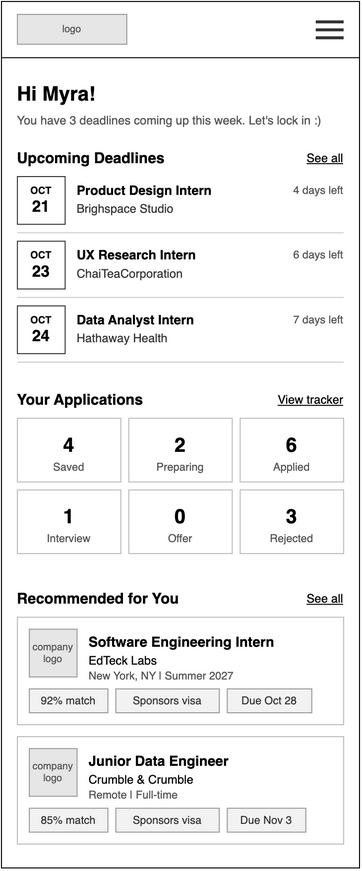

#### 7. Home with Menu Open

Tapping the menu button on any logged-in screen slides this menu in from the right. It links to every main section and has the Log Out option. Tapping "Close" or the darkened area closes it. Home is shown underneath, but the menu works the same way from every screen.

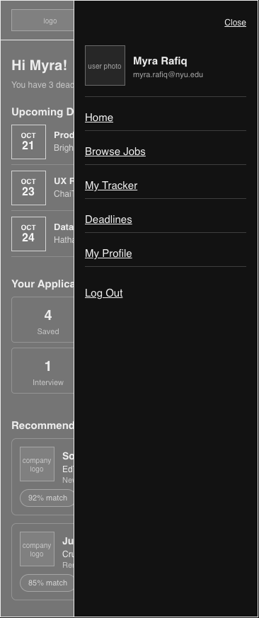

---

### Finding Jobs

#### 8. Browse Jobs

Lists the internships and entry-level jobs on CareerHive. Users can search by title, company, or skill.

- The tags under the search bar are the filters currently applied. Tapping one removes that filter.
- "Sort" is a regular dropdown with three options: best match, deadline (soonest first), and newest.
- Each card shows the AI match score, whether the company sponsors visas, and the deadline, so users can decide quickly if it's worth opening.

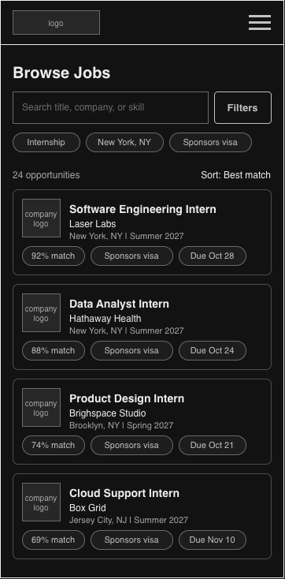

#### 9. Browse Jobs with Filters Open

Tapping "Filters" opens this panel from the bottom of the screen. Users can filter by job type, location, visa sponsorship, and deadline. The button shows how many results match and closes the panel when tapped. "Clear all" resets every filter.

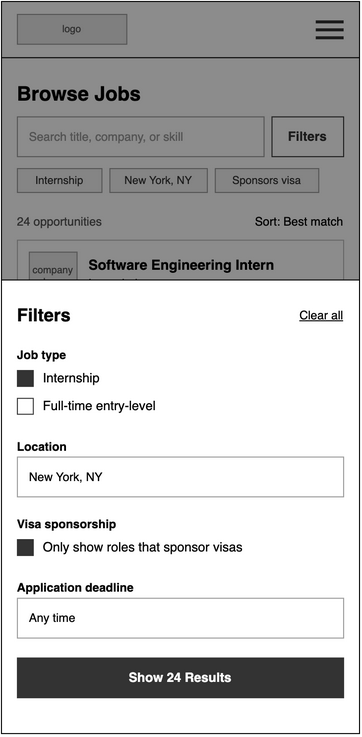

#### 10. Job Details

The full page for one job listing.

- The info box at the top has the deadline, posting date, visa sponsorship / work authorization info, and pay.
- **Save to Tracker** adds the job to the user's tracker (see screen 11). Once it's saved, the button changes to show the current stage, like "In Tracker: Saved", and tapping it opens the application in **My Tracker**.
- **Apply on Company Site** opens the company's official application page in a new tab. CareerHive doesn't handle the actual application just yet.
- **AI Match** gives a short summary of how well the job fits the user's profile. "See full analysis" opens the full breakdown (screen 12).
- **Discussion** previews the two most recent posts. "View all" opens **Job Discussion**.

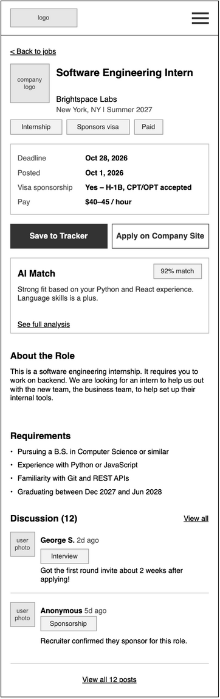

#### 11. Job Details with Save to Tracker

A pop-up that opens when the user taps "Save to Tracker". They choose which stage the application starts in (Saved by default) and can add a note. Tapping "Save" adds it to the tracker and closes the pop-up.

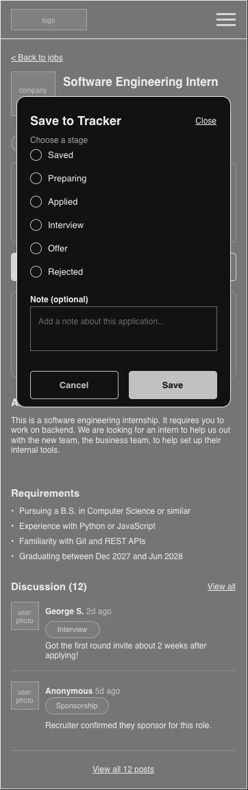

#### 12. Job Details with AI Match Analysis

A pop-up that opens from "See full analysis". It compares the user's profile with the job description and shows:

- the overall match score
- why the job could be a good fit
- skills from the listing the user doesn't have yet
- a short summary of the key qualifications

There's a note at the bottom reminding users this is AI-generated and they should still read the full listing.

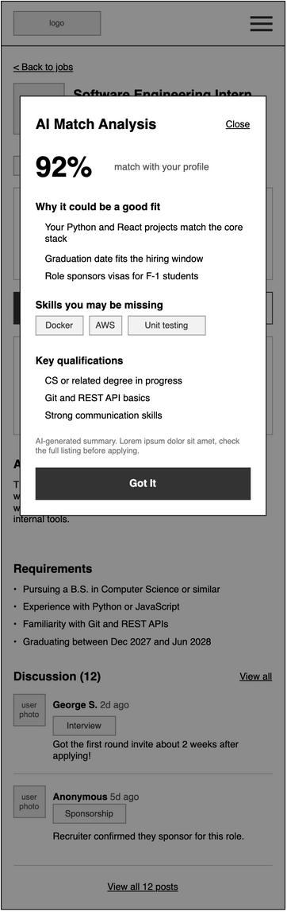

#### 13. Job Discussion

A public discussion board for one job listing, where applicants share things like interview timelines, online assessments, sponsorship info, and application updates.

- The topic tags at the top filter the posts. "All" is selected by default.
- Every post is tagged with a topic so it's easy to find specific info.
- Posts are listed newest first.

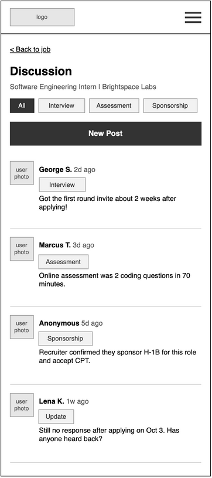

#### 14. Job Discussion with New Post

A pop-up for writing a new post. The user picks a topic, writes their post, and can choose to post anonymously. Tapping "Post" adds it to the top of the discussion.

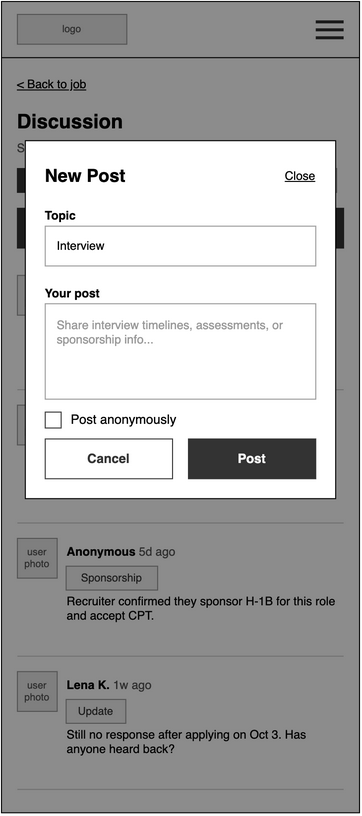

---

### Tracking Applications

#### 15. My Tracker

Shows every job the user has saved, grouped by stage: Interview, Applied, Preparing, Saved, Offer, and Rejected.

- The "Stage" dropdown shows just one stage, and "Sort" orders applications by deadline or by last updated.
- Each stage shows up to two applications. "Show more" expands the rest of that group.
- Tapping an application opens **Application Details**.

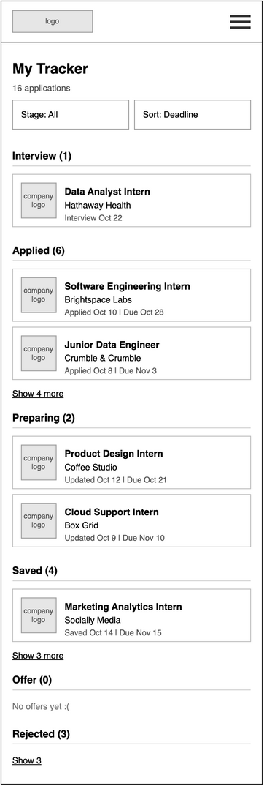

#### 16. Application Details

Where the user manages a single application.

- Shows the current stage, the deadline and how many days are left, and a history of when the application moved between stages.
- Users can write notes, like referrals or reminders to follow up, and save them.
- "View job listing" opens the original **Job Details** page.
- "Update Stage" and "Remove from Tracker" open pop-ups (screens 17 and 18).

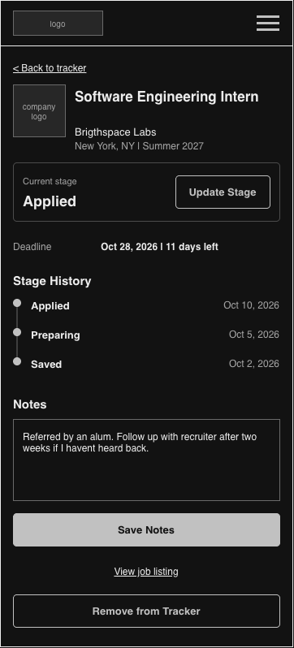

#### 17. Application Details with Update Stage

A pop-up for moving the application to a different stage. The current stage is selected when it opens. After tapping "Update", the new stage and today's date are added to the stage history.

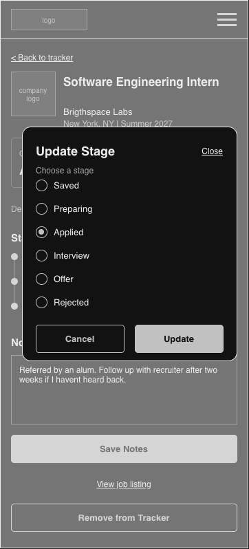

#### 18. Application Details with Remove Confirmation

Asks the user to confirm before an application and its notes are removed from their tracker, since this can't be undone. Tapping "Remove" takes them back to **My Tracker**.

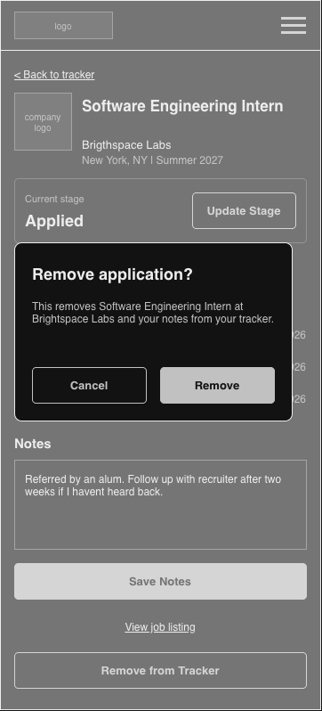

---

### Deadlines

#### 19. Deadlines

Lists upcoming deadlines for every job in the user's tracker, soonest first, so nothing gets missed.

- The tabs at the top switch between this week, this month, and all deadlines.
- Each row shows the date, the job, which stage it's in, and how many days are left.
- Tapping a row opens its **Application Details**.
- Jobs in the Offer or Rejected stage aren't shown here.

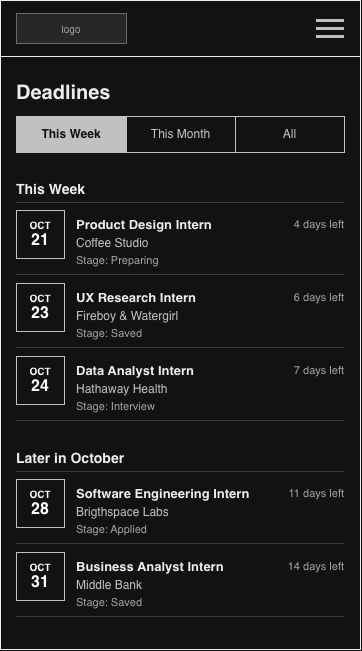

---

### Profile

#### 20. My Profile

Shows the info the user entered during Profile Setup: education, skills, the types of roles they want, preferred locations, and work authorization. "Edit Profile" lets them change it, and "Log Out" signs them out and goes back to **Welcome**.

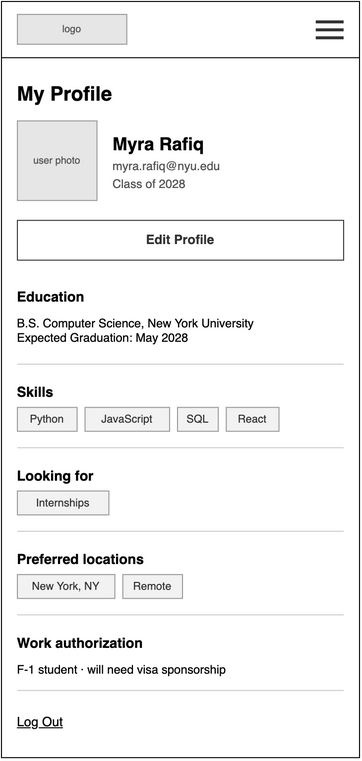

#### 21. Edit Profile

The same form as Profile Setup, with the user's current info already filled in. Users can also change their name and profile photo here. "Save Changes" updates their profile, and job recommendations and match scores change to reflect it. "Cancel" goes back without saving.

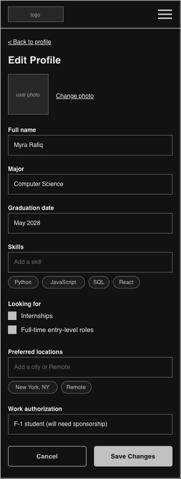
